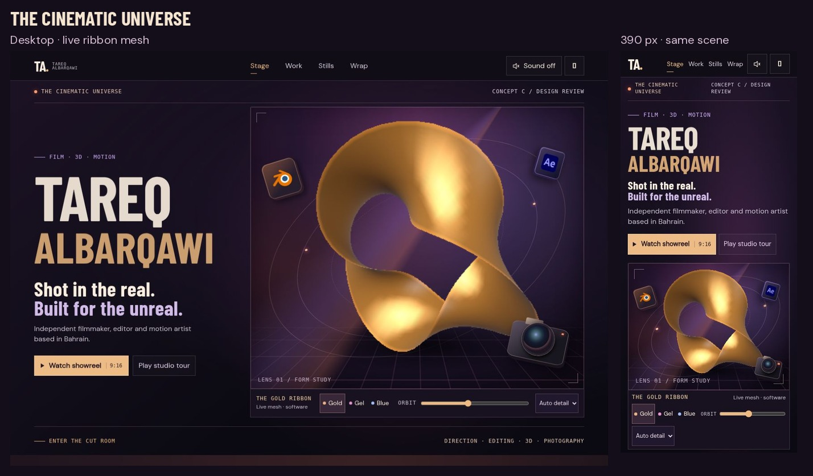

# Concept C — The Cinematic Universe

[Open the owner-only design review](https://tareq-portfolio-v8-phase1-review.fortunepromo-4605.chatgpt.site/). Choose **Enter the universe**, then **Play studio tour** for a roughly 15-second walk through the scene, archive, darkroom, and slate. The tour runs the real controls and is stoppable. Or explore at your own pace. Both earlier concepts are still on the comparison page.



[More screenshots: edit room, darkroom, finale, and Geralt](screens/Concept_C_Chapters.jpg) · [Measured browser evidence](browser-evidence.json) · [V7 audit](../v8-phase-1/v7-audit.md)

## What changes

V7's stage, work, photographs and ending were all interesting on their own. Concept C makes them feel as though they belong to one film. Amber key light and violet gels connect the gold sculpture to the edit room. The exhibit then borrows its colors from the actual photographs. The closing slate brings the work back to a physical object and leaves room for the contact links. The headings gate open on entry; as you scroll, the stage camera, pools of light, and practical props change position. The edit bench holds the motion when the visitor wants to inspect a source frame.

| Direction | What leads | What it does well | How Concept C responds |
| --- | --- | --- | --- |
| V7 Final Hotfix | Gold ribbon, floating tools, camera and recording chrome | A distinct world with real video, 3D, Geralt, photos and sound | Gives the sculpture deliberate shot framing and three editable lights; carries the visual language through the monitor, darkroom and closing slate. |
| A / Digital Studio | Object study and thumbnail drawer | Clear hands-on studio interaction | Keeps operating the stage and viewing a single monitor, but brings the live sculpture into the default experience. Building a model is not an optional add-on to an otherwise still page. |
| B / Director's Cut | Film still and editorial index | Clear project hierarchy and strong photography | Keeps the work discoverable and foregrounds the original images, while restoring a live world around them. |
| C / Cinematic Universe | Live stage that leads into edited chapters | Visitors can influence the light, framing, source frames, darkroom and final slate | The proposed direction for the next review, subject to visual approval and real GPU testing. |

## Try these

- **Stage:** Drag the ribbon on desktop or use the Orbit slider on a phone or keyboard. Pick Gold, Gel or Blue. The same mesh responds to pose and key light. Full and Balanced change the drawing buffer. The camera and software badges are set dressing in this study, not the finished V7 camera controls.
- **Cut room:** Select any of the eight real projects. Sweep the monitor, use the frame timeline, or press Home/End on the slider. Seven films have the 33 authentic review stills and original timings from V7. Playthings stays on its original YouTube link. The main reel is the correct full `CYh5Zr_7LJ8` vertical edit, and the review includes a 12-second native excerpt of *A Quiet Trail*. Other films use the existing frame sheets/posters and YouTube links where present.
- **Darkroom:** Pick a print to transition to that photograph and light the room from its palette. Enlarge it and move between images with the viewer’s buttons or arrow keys. Look behind the print while it is in view. Geralt's original SVG moves into an accessible discovery dialog and then becomes a fixed companion.
- **Wrap:** Click the clapper to move the hinge, update Scene/Take, spill warm light, and spin the reel. The original 75% take / 25% next scene rule is used. **Sound** enables native audio from the original interaction cues; it starts off, and volume for the films is separate. Motion pause and system reduced motion leave the controls available.

## Performance approach and evidence

The parametric V7 ribbon still has its three half-twists. Its WebGL path uses an indexed mesh, a single material pass, and studio-card reflections from a compact shader. At full detail it has 8,640 triangles and caps the buffer at 1.55 million pixels, compared with V7 desktop's 13,824 and 2.2 million. Balanced uses 4,224 triangles and a 740,000-pixel cap. Auto starts at an appropriate tier and can step down after sustained late frames. Neither mode reduces the set of authored interactions.

A single frame coordinator coalesces pointer/scroll, stage easing and scrub work. It stops drawing at rest, when the hero leaves view, or while a dialog is open. Lights and chapter cuts mostly move or fade bounded surfaces. Film preview loads one active sheet; playback media is requested only on a deliberate click. No global cursor replacement, autoplaying background video, or persistent global render loop.

When the browser can't provide a suitable WebGL context, it renders the same geometry with a bounded software rasterizer with real perspective, lighting and depth testing. A no-renderer browser can show the original still. The fallback is still an interactive 3D scene in the environment tested, not a rotation of the original poster.

**34 targeted Chromium assertions passed.** This includes a 320/390/768/1280 px layout check, pointer and keyboard orbit, render quality and idle/offscreen checks, the tour, genuine frame updates, photo viewer and color, Geralt, slate, and native reel playback at desktop and 390 px. The lab used the software renderer (2,560 triangles). The balanced desktop buffer was 467 × 395; Full was 604 × 512. Across a 33.4 s idle observation the draw count stayed 1 → 1. The draw count also stayed fixed when the edit room was in use. Render work after warmup in one small sample typically took a few milliseconds; the diagnostic logged long animation frames of 141 and 79 ms in a separate load-to-gallery run. These are not field INP, proof of smoothness on all desktops, or hardware GPU measurements. The clip and resizing checks are browser tests at mobile widths, not physical Safari or Android tests. Audio opt-in state was checked, not perceived volume or fidelity. See the JSON and [paired machine protocol](../v8-phase-1/v7-audit.md#baseline-measurement-protocol).

The next technical gate after creative approval is to run the matched V7/C trace on an affected and unaffected desktop and a real phone. Record WebGL availability/renderer, DPR, shader startup, p95 frames during orbit/scroll, LoAF attribution and playback-seek behavior. Compare at equivalent visual quality. A static fallback profile cannot establish the performance of the full scene. Prototype instrumentation is available with `?profile` on the C URL; read the stage's `data-draws`, `data-draw-costs`, `data-quality`, and `data-buffer`, and the root's `data-long-frames` and `data-media-transfers`.

References: [MDN WebGL best practices](https://developer.mozilla.org/en-US/docs/Web/API/WebGL_API/WebGL_best_practices) · [Rendering on demand](https://threejs.org/manual/pages/rendering-on-demand.html) · [Chrome Long Animation Frames](https://developer.chrome.com/docs/web-platform/long-animation-frames).

## Carry into production after approval

Keep the readable Q, original gold ribbon and filmmaking props, real reel and project films in their original ratios, all credits and contact links, frame-perfect preview times, the nine original photographs, About/Experience/CV, Geralt's signature hiding/discovery/fixed companion, opt-in cues, and “THAT’S A WRAP” with the scene/take slate. Add the complete video library and camera/lighting refinements only in separate reviewed changes. Keep the project masters outside source control, and validate the delivery plan and captions on staging. V7 itself and the original A/B concept files are retained verbatim; only the comparison landing now adds C.

## Run locally

From the repository root:

```sh
python3 -m http.server 8000 --bind 127.0.0.1
# Open http://127.0.0.1:8000/v8/phase-1b/index.html
```

To assemble the private review, including A/B and only the necessary assets:

```sh
python3 v8/phase-1b/tools/build-review.py /absolute/path/to/new-review-folder
```

[Review media provenance](media-provenance.md). `main`, the production Netlify deployment, and `v8-development` stay protected. **No Phase 2 implementation has started.**
